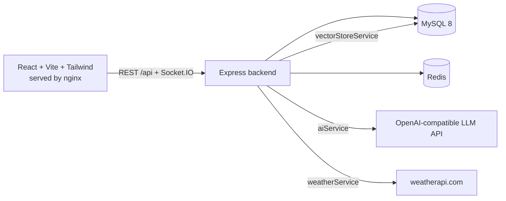

# AgroSathi

A platform that connects farmers with human agricultural agents and adds AI help on top: grounded Q&A, weather with rain probability, support tickets and real-time chat.

## Features
- **Farmers:** register, manage profile and crops, see weather and rain chances with plain-language alerts, ask the AI, open support tickets, chat with their assigned agent, get notifications.
- **Agents:** see assigned farmers with crop, location, issue and priority, work tickets, chat in real time, use AI Assist (summarize, possible causes and questions, draft or improve a reply). AI only suggests; the agent sends.
- **Admins:** manage users, assign/reassign/unassign agents with workload view, monitor tickets and conversations (read-only), manage knowledge documents, crop categories and locations, view AI usage, weather alerts and audit logs.
- **Safety:** AI answers carry a disclaimer and point to the human agent. If AI or weather fails, the rest of the app keeps working.

## Architecture

nginx serves the built frontend and proxies `/api` and `/socket.io` to the backend, so the HTTP-only auth cookie is same-origin.

The backend is one Express app with replaceable services in `backend/src/services`:

| Service | Responsibility |
|---|---|
| `aiService` | LLM calls, prompts, farmer/crop context, agent assist, usage logging, fallbacks |
| `vectorStoreService` | Chunking, embeddings, similarity search. Vectors are stored in MySQL; swap this file to use Qdrant, pgvector or similar |
| `weatherService` | Provider call, normalization, Redis + MySQL cache, alert rules |
| `notificationService` | Persist notifications in MySQL and push over Socket.IO |
| `assignmentService` | Assign, reassign, unassign, workload, optional agent suggestion |
| `chatService`, `presenceService`, `auditService`, `farmerService` | Messages, online status (Redis), audit trail, shared lookups |

Redis is used for: weather cache, rate limiting, online presence, and the weather-alert job's duplicate protection. A separate AI microservice was not added: it would not give a real benefit at this size.

## Tech stack
React 18, Vite, Tailwind CSS, React Router, Axios, Socket.IO client, Recharts. Node 20, Express, Socket.IO, JWT in HTTP-only cookies, bcryptjs, Zod, Helmet, CORS. MySQL 8, Redis 7. Docker Compose. Jest and Supertest.

The backend uses CommonJS (`require`). The frontend uses ES modules because Vite and the browser require them.

## Folder structure
```
agrosathi/
├── backend/        Express app: src/{routes,services,middleware,jobs}, tests/
├── frontend/       React app: src/{pages,components,context,api}, nginx.conf
├── database/       schema.sql, seed.sql
├── docs/API.md     API and WebSocket reference
├── docker-compose.yml
└── .env.example
```

## Database schema
`database/schema.sql` creates (InnoDB, utf8mb4, primary and foreign keys, unique constraints, indexes, timestamps):
`users`, `farmer_profiles`, `agent_profiles`, `farms`, `crops`, `crop_categories`, `locations`, `agent_assignments`, `tickets`, `ticket_messages`, `conversations`, `conversation_messages`, `notifications`, `weather_cache`, `knowledge_documents`, `knowledge_chunks`, `ai_conversations`, `ai_messages`, `ai_usage`, `audit_logs`.

Notes: farmer and agent references point at `users.id`. A farmer can have only one active agent (enforced by a unique key on the active assignment). Each farmer has one conversation. Chunks cascade-delete with their document.

## Environment variables
Copy `.env.example` to `.env` and edit.

| Variable | Purpose |
|---|---|
| `MYSQL_ROOT_PASSWORD`, `DB_NAME`, `DB_USER`, `DB_PASSWORD` | MySQL setup and backend connection |
| `JWT_SECRET`, `JWT_EXPIRES_IN` | Token signing and lifetime. Generate with `openssl rand -hex 48` |
| `AI_API_KEY`, `AI_BASE_URL`, `AI_MODEL` | Chat model (any OpenAI-compatible API) |
| `EMBEDDING_PROVIDER`, `AI_EMBEDDING_MODEL` | `local` (built-in hashing embedder) or `provider` (API embeddings) |
| `WEATHER_API_KEY`, `WEATHER_CACHE_TTL_SECONDS`, `WEATHER_ALERT_JOB_MINUTES` | Weather provider key, cache time, alert check interval |
| `FRONTEND_URL`, `BACKEND_URL`, `REDIS_URL`, `LOG_LEVEL` | URLs and logging |

`.env` is git-ignored. Keys are read only by the backend and never sent to the browser.

## Running locally
Requires Docker with Compose.

```bash
cp .env.example .env      # then set passwords and JWT_SECRET
docker compose up --build
```
- App: http://localhost:5173
- Backend: http://localhost:5000/api/health
- MySQL is published on host port 3307, Redis on 6379.

The schema and seed data load automatically the first time the MySQL volume is created. Knowledge documents are indexed at first startup when the vector table is empty.

Run the tests (they use the running MySQL and Redis):
```bash
docker compose exec backend npm test
```
Tests cover registration, login, authentication, RBAC, ticket creation, assignment and authorization, plus the embedder and alert rules.

## Default development credentials
Development only. Never use these anywhere else. All accounts use the password `Password@123`.

| Role | Email |
|---|---|
| Admin | `admin@agrosathi.dev` |
| Agents | `rahul.agent@agrosathi.dev`, `meera.agent@agrosathi.dev`, `imran.agent@agrosathi.dev` |
| Farmers | `ramesh@`, `sunita@`, `gopal@`, `lakshmi@`, `mohan@` + `agrosathi.dev` |

The seed has 1 admin, 3 agents, 5 farmers, crops, tickets, conversations and notifications with invented names. Mohan has no agent yet, so you can try assigning from the admin screen.

## AI configuration
Set `AI_API_KEY`, `AI_BASE_URL` and `AI_MODEL` in `.env`. Any OpenAI-compatible endpoint works (OpenAI, Azure OpenAI, Groq, a local Ollama, and so on). Without a key, the AI screens show a clear unavailable message, search over the knowledge base still works, and everything else runs.

RAG flow: question, embedding, vector search over knowledge chunks, top passages plus farmer and crop context into the prompt, answer with sources. The default `local` embedder is a hashing embedder: it matches on shared words and works offline, but it is weaker than a real embedding model. For better retrieval set `EMBEDDING_PROVIDER=provider`, then run **Knowledge base > Reindex all** as admin.

## Weather configuration
Create a free key at weatherapi.com and set `WEATHER_API_KEY`. Without a key, weather cards show "not configured" and nothing else breaks. Responses are cached in Redis and stored in MySQL, so a provider outage serves the last saved forecast. A background job checks farmers' forecasts and sends general alerts (heavy rain, heat, frost, strong wind), at most one per kind per farmer per day. Alerts are guidance only and suggest contacting an agent.

## Troubleshooting
- **Backend exits at start:** a required variable is missing. Check `.env` against `.env.example`.
- **Changed DB passwords or schema and it fails:** the MySQL volume keeps the old data. Reset with `docker compose down -v`, then `docker compose up --build`.
- **Port already in use:** change the left side of the port mappings in `docker-compose.yml`.
- **Cannot log in after changing `JWT_SECRET`:** log in again.
- **AI says unavailable:** key or base URL is wrong. See the backend log and **Admin > Settings**.
- **No weather:** set `WEATHER_API_KEY`, and check the farmer has a district/state or coordinates.

## Future improvements
Automatic agent assignment (the `suggest` endpoint is the starting point), a dedicated vector database, Hindi and other regional languages in the UI, image upload for crop disease photos, SMS/WhatsApp notifications, email password reset, OpenAPI/Swagger spec.
